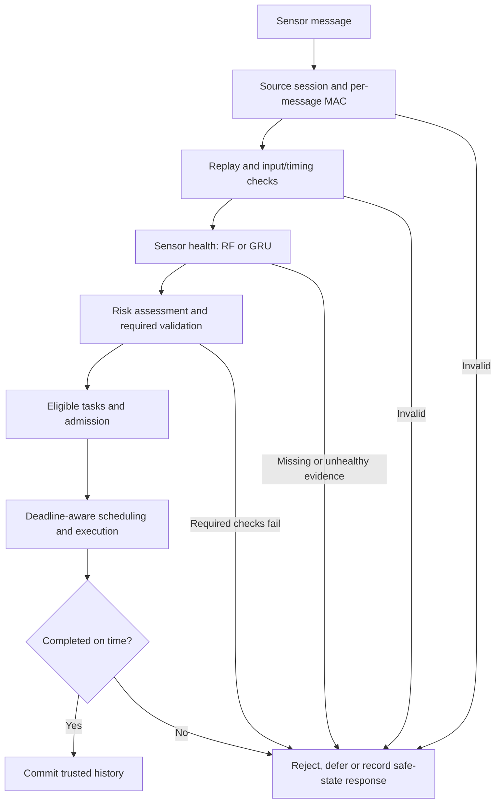

# Security-Aware Real-Time Sensor Scheduling System

A Python research prototype that combines authenticated sensor messages, sensor-health models and deadline-aware scheduling. Its Streamlit laboratory lets you configure recurring tasks and security events, run the actual backend, and inspect admission decisions, security checks, execution traces and deadline outcomes.

**Scope:** execution is simulated. This is not an RTOS, a certified safety controller, or a guarantee that every critical job meets its deadline under arbitrary overload.

## Contents

- [Problem statement and objectives](#problem-statement-and-objectives)
- [Key features](#key-features)
- [Documentation deliverables](#documentation-deliverables)
- [Architecture and data flow](#architecture-and-data-flow)
- [Scheduling algorithms and policies](#scheduling-algorithms-and-policies)
- [Security pipeline](#security-pipeline)
- [Machine learning and domain boundaries](#machine-learning-and-domain-boundaries)
- [Repository structure](#repository-structure)
- [Prerequisites and installation](#prerequisites-and-installation)
- [First run](#first-run)
- [Run the dashboard](#run-the-dashboard)
- [Tests and verification](#tests-and-verification)
- [Model training and evaluation](#model-training-and-evaluation)
- [Scheduling experiments and algorithm comparisons](#scheduling-experiments-and-algorithm-comparisons)
- [Datasets and reproducible artifacts](#datasets-and-reproducible-artifacts)
- [Configuration](#configuration)
- [Metrics and interpretation](#metrics-and-interpretation)
- [Example execution](#example-execution)
- [Troubleshooting](#troubleshooting)
- [Research reproducibility](#research-reproducibility)
- [Security considerations and research limitations](#security-considerations-and-research-limitations)
- [Repository size and GitHub preparation](#repository-size-and-github-preparation)
- [Future work](#future-work)
- [License and attribution](#license-and-attribution)

## Problem statement and objectives

The deadline budget must include authentication, validation and modeled protection overhead. A schedule based only on base computation can appear feasible while required security makes it late. The objectives are to preserve mandatory gates, adapt modeled protection to current risk, prioritize feasible critical work during overload, account for every fixed-point cost, and evaluate against explicit baselines on identical workloads.

The intended scenario is a research sensor-processing laboratory, not a certified vehicle controller. Water-testbed anomaly detection and legacy login risk remain separate experimental domains.

## Key features

Security verification and health inference consume time; stronger protection and frequent preemption can make a previously feasible workload miss deadlines. This project explores that trade-off while keeping authentication, replay checks and required protection mandatory.

- Source challenge-response sessions, per-message HMAC-SHA256 integrity, replay rejection, expiry and revocation.
- Input/timing validation, vehicle Random Forest (RF) health checks and a separate SKAB-domain GRU detector.
- Risk-derived validation requirements, fail-closed handling and trusted history committed only after successful execution.
- Periodic, sporadic and one-shot tasks; absolute deadlines; phases and fixed preemption points.
- Admission, protected-work reservations, overload handling and dynamic risk adaptation.
- Original and optimized scheduling strategies with actual Gantt traces, event playback, CSV/JSON exports and paired comparisons.
- Saved datasets, model artifacts, tests, research protocols and reproducible experiment evidence.

## Documentation deliverables

- [Presentation quick reference](docs/Presentation_Quick_Reference.pdf): five-page speaking guide.
- [Complete technical documentation](docs/Complete_Technical_Documentation.pdf): implementation, policy rules, examples and developer workflow.
- [Presentation flowchart](docs/Project_Workflow_Flowchart.png) and [editable Mermaid](docs/Project_Workflow_Flowchart.mmd).
- [Command contracts and verification status](docs/documentation_sources/Command_Reference.md): inputs, outputs, errors and which commands were actually executed.

## Architecture and data flow



The laboratory uses `src/lab/simulation.py` and `SecurityRuntime` to call the production pipeline in `src/security/sensor_system.py` before invoking `src/scheduler/ra_lp_edf.py`. Each laboratory run isolates sessions and histories. Dashboard explanations are derived from recorded backend events, not invented schedules.

The older live-message panel and legacy login-risk demonstration remain available. Their interfaces and models are retained for compatibility; they are distinct from the recurring-task laboratory.

## Scheduling algorithms and policies

| Mode | Implemented behavior |
|---|---|
| Legacy EDF | Non-preemptive sensor-task EDF with critical-only fallback in `src/scheduler/scheduler.py`. |
| `Standard-EDF` | Fixed-light protection with configurable checkpoint approximation. Rejects requirements it cannot meet. |
| `Static-Sec-EDF` | Fixed strong protection and checkpoint EDF. |
| `MPS-LP-EDF-structural` | Structural multi-phase limited-preemption baseline and separate static analysis; not a dynamic-risk guarantee. |
| `SAEDF-style` | Single-CPU stronger-protection preference; not a reproduction of a distributed-cluster implementation. |
| `RA-LP-EDF` | Original risk-aware fixed-point EDF, admission, conservative protected budgets and overload handling. Laboratory default. |
| `RA-LP-EDF-Admission` | Critical-first feasible-subset selection and deferred-job recovery. |
| `RA-LP-EDF-Preemption` | Avoids an interruption when a complete-current-first bound still meets all released deadlines. |
| `RA-LP-EDF-Optimized` | Combines subset admission, limited interruption and least-full-cost compliant mechanism selection with event-local budget caching. |

A job's absolute deadline is its release plus relative deadline. The release horizon stops new releases; already released jobs drain to terminal outcomes. Admission checks bound remaining released demand, including modeled security and transition costs. Reservations protect selected remaining critical demand, not all future arrivals. Preemption occurs only at configured phase/chunk boundaries and respects caps; atomic security intervals are not interrupted merely to improve a metric.

Risk increases can require stronger protection immediately. An increase inside an under-strength atomic interval triggers safe stop/cleanup. Recovery respects hysteresis and dwell. In overload, work can be deferred or rejected, and infeasible protected work produces an explicit safe-state event. No deadlines or workload budgets are silently changed.

The optimized mode can save deadlines and overhead, but is **not uniformly superior**: optional stronger protection selected by the original policy can survive an unexpected spike that forces least-cost protection to stop. The original remains the default. See [design and reference sections](docs/scheduling_design.md), [optimization methodology and counterexample](docs/scheduler_optimization.md), and [paired results](results/optimization/report.md).

## Security pipeline

1. A sensor proves possession of a provisioned demonstration secret using a random challenge bound to identity and receiver context.
2. A short-lived session establishes a derived message key. Every message still requires a MAC over its canonical contents.
3. Session validity and increasing source-wide sequence numbers reject expired, revoked, replayed or reordered messages. Replay counters survive reauthentication.
4. Input/timing, deterministic sensor checks and the selected ML backend supply required health evidence.
5. The risk policy selects mandatory additional checks; unavailable evidence fails closed.
6. Only eligible tasks reach scheduling. Only successfully completed, on-time work updates trusted feature/health history.

The application risk policy adapts **NIST SP 800-30 Rev. 1, section 3.2 Task 2-6 and Appendix I Table I-2**, with OT context from **NIST SP 800-82 Rev. 3, sections 4.1.2–4.1.3**. Sensor thresholds, costs and scheduler rules are project choices, not NIST prescriptions. The scheduling simulator's exposure/impact model is also a configured scenario model, not a calibrated probability of attack. See [policy and official source links](docs/risk_validation_policy.md), [research note](docs/policy_research_note.md) and [session protocol](docs/source_authentication.md).

The sensor validation names are `standard`, `additional`, `enhanced`, `reject` and `unavailable`. They supplement mandatory MAC/replay, not replace it. The scheduler's `light`, `medium`, `strong` names denote modeled cost/protection levels. Legacy login actions (`password`, `password_plus_mfa`, `strong_mfa`, `throttle_and_strong_mfa`, `temporary_block`) are separate action descriptors; an interactive MFA provider is not implemented. See technical Chapters 9-10 for thresholds, checks and costs.

## Machine learning and domain boundaries

| Component | Intended input and output | Artifact |
|---|---|---|
| Vehicle RF | Vehicle-message features and distance plausibility; normal, anomalous-reading or faulty classification | `models/sensor_health_model.joblib` |
| GRU | Ordered windows of eight SKAB physical measurements; binary normal/anomalous classification | `models/gru_sensor_health.pt` plus matching `.json` metadata |
| SKAB RF comparison | RF refitted to SKAB endpoint features for a same-domain comparison | `models/skab_random_forest.joblib` |
| Legacy login model | Retained login-risk demonstration | `models/login_risk_model.joblib` |

The production sensor module defaults to GRU; vehicle laboratory presets explicitly select RF. GRU requires signed SKAB features, recording/session context and trusted startup history. It does not convert a vehicle distance into water-process measurements and does not silently fall back to RF when evidence is missing.

**SKAB is a water-circulation testbed, not a vehicle-sensor or authenticated cyberattack dataset.** Its anomaly labels do not establish sensor fault, malicious-source attribution or vehicle-domain accuracy. The saved GRU evaluation uses grouped recordings/overlap controls, training-only scaling, validation-selected threshold and a held-out test. The saved GRU has lower held-out macro-F1 than the refitted SKAB RF despite its smaller inference artifact. See [GRU protocol and limitations](docs/gru_sensor_model.md) and [measured model evaluation](results/gru/evaluation_report.md).

### Model protocol and verified saved results

Vehicle RF uses 300 balanced trees, seed 42, nine numeric/two categorical features and a grouped 25% run holdout. SKAB uses training-only scaling and overlap-group separation: 33,623 training, 4,863 validation and 5,153 test windows. The saved GRU has one layer, hidden size 32, window 20, dropout .2 and threshold .84, selected by validation before the held-out test. Saved GRU accuracy/macro-F1 are .8317/.8143 versus .8413/.8248 for the separate SKAB RF refit; this does not establish vehicle accuracy. The login model's original training/split provenance is not available.

## Repository structure

```text
.
├── data/
│   ├── raw/                 # Vehicle/login CSVs and original SKAB files/license
│   ├── processed/skab/      # Prepared arrays and manifests used by evaluation/tests
│   ├── skab/                # Source hashes, split/scaler configuration, provenance
│   └── SKAB_DATASET.md
├── models/                  # Required RF, GRU and legacy inference artifacts
├── src/
│   ├── dashboard/           # Streamlit application and comparison panels
│   ├── lab/                 # Workload validation, real security gates, simulation
│   ├── scheduler/           # Legacy EDF, RA engine, analysis, costs and metrics
│   ├── security/            # Sessions, integrity/replay, health and risk validation
│   └── ml/                  # Data preparation, training, evaluation and benchmarks
├── tests/                   # Security, models, schedulers and dashboard tests
├── scripts/                 # Experiment/report runners and repository audit
├── docs/                    # Design, protocols, traceability and limitations
├── results/                 # Preserved metrics, full traces and verification evidence
├── requirements.txt         # Pinned dependencies
└── .gitignore               # Local environments/caches/secrets; keeps research assets
```

## Prerequisites and installation

Validated with **Python 3.12.6**. Main dependencies are PyTorch, scikit-learn, NumPy, pandas, joblib, Streamlit, Altair, Matplotlib and pytest; use the complete pinned `requirements.txt`. A GPU is not required for saved-model inference. PyTorch installations with CUDA libraries can occupy several GB independently of this repository.

Run all commands from the repository root. Create a local environment after cloning:

```powershell
python -m venv .venv
.\.venv\Scripts\Activate.ps1
python -m pip install --upgrade pip
python -m pip install -r requirements.txt
python -m pip check
```

On Linux/macOS, activate with `source .venv/bin/activate` instead. If PowerShell activation is restricted, invoke `.\.venv\Scripts\python.exe -m ...` directly; changing machine execution policy is not necessary.

The local environment is intentionally excluded from Git and from the cleaned distribution. Recreating it can increase local disk usage beyond the packaged repository size. The cleanup verification environment's installed versions are recorded in [installed-requirements.txt](results/repository_cleanup/installed-requirements.txt); its CUDA-specific wheel build is provenance, not an instruction to replace the portable root dependency manifest. Fresh installation on every OS/hardware combination is not certified.

## First run

1. From the project root, create/activate the environment and install `requirements.txt` using the setup commands above.
2. Confirm the included `models/`, vehicle CSV and prepared SKAB files are present. Acquisition, preparation and retraining are **optional**, not prerequisites when included assets are intact.
3. Launch the dashboard below. Select **Normal operation**, run the laboratory, inspect actual gate outcomes and job deadlines.
4. Load **Tampered and replayed** to demonstrate mandatory rejection. Compare original and optimized on an unchanged workload.
5. Export JSON/CSV from the result tabs. For standalone login output, optionally run `python -m src.security.security_system`; it is a separate legacy simulation.

Every command below is root-relative. The [command ledger](docs/documentation_sources/Command_Reference.md) specifies required inputs, expected outputs, overwrite risks and verification status. Source/CLI verification is not claimed as a new network installation or training run.

## Run the dashboard

```powershell
python -m streamlit run src/dashboard/app.py
```

Open the localhost URL printed by Streamlit. In **Simulation Setup**, select a preset or edit task templates, release horizon, deadlines, criticality, phases and security events. Use **Run laboratory**, then inspect **Live Simulation**, **Security and Sensor Monitoring**, **Results and Analysis**, and **Algorithm Comparison**.

For the optimized comparison, choose **Compare algorithms**, select `RA-LP-EDF` and `RA-LP-EDF-Optimized`, and run the same configuration. Both actual Gantts and critical/total completion counts appear side by side. The **Tampered and replayed** preset exercises real gates. Exports include workload JSON, complete run JSON and job/event/security CSVs. See [laboratory guide](docs/laboratory.md).

## Tests and verification

```powershell
python -m pytest -q --tb=short
python -m compileall -q src tests
python -m src.ml.validate_sensor_dataset
```

Tests cover sessions, tamper/replay bypass attempts, missing evidence, trusted history, RF/GRU paths, admission/reservations, exact modeled costs, fixed-point preemption, overload, risk transitions, recurring deadlines and Streamlit UI/backend correspondence. The pre-cleanup implementation passed 278 tests; [cleanup verification](docs/repository_cleanup_report.md) records the actual post-cleanup result and preservation audit.

## Model training and evaluation

The saved artifacts and prepared data are included, so retraining is not required to run the application or tests. Training changes model artifacts and results: do it in a separate checkout or preserve originals first.

```powershell
# Vehicle RF: trains and writes the vehicle model/report
python -m src.ml.train_sensor_model

# Vehicle RF diagnostics: output to a new directory
python -m src.ml.evaluate_sensor_model --all-runs --output-dir results/local_rf_evaluation

# SKAB recovery/preparation; unnecessary when included files are intact
python -m src.ml.skab_dataset acquire
python -m src.ml.skab_dataset prepare

# GRU candidate training and evaluation
python -m src.ml.train_gru_sensor_model --epochs 30 --batch-size 256 --lr 0.001 --seed 42
python -m src.ml.evaluate_gru_sensor_model
python -m src.ml.cross_validate_gru
python -m src.ml.benchmark_gru_pipeline
```

Acquisition is pinned and verifies original hashes; it refuses conflicting originals. Evaluation refuses to overwrite its existing held-out test report. Some other training/evaluation scripts use fixed output paths, so preserve the recorded experiment directories first. Outputs include model weights/JSON metadata, epoch histories, endpoint predictions, per-class metrics, PR curves and timing JSON. See [detailed commands and protocol](docs/gru_sensor_model.md).

## Scheduling experiments and algorithm comparisons

```powershell
# Fresh output directory: the existing scheduler experiment runner
python -m src.scheduler.experiments --full --workers 4 --output results/local_scheduling

# Authenticated presets, comparisons and repeated trials
python scripts/evaluate_laboratory.py --output results/local_laboratory

# Saved optimization comparison and trace consistency report
python scripts/report_optimization.py

# Reproduce optimization stages only after preserving their existing directories
python scripts/benchmark_optimization.py baseline --workers 4 --seeds 20
python scripts/benchmark_optimization.py optimized --workers 4 --seeds 20
python scripts/evaluate_optimized_laboratory.py

# Per-message authentication versus session reuse, in a new output file
python -m src.ml.benchmark_source_auth --messages 1000 --repetitions 10 --output results/local_source_auth.json
```

The optimization benchmark refuses to overwrite a completed stage. The authenticated optimization evaluator writes to its fixed laboratory output directory; preserve existing evidence before running it. `scripts/report_scheduling.py` analyzes the saved canonical scheduling results. Experiment outputs include exact task sets, seeds, source hashes, policy parameters, raw metrics, full traces, aggregates and paired statistics. The current algorithm registry includes the optimized modes; historical reports retain the algorithm population used when they were produced.

The saved 20-seed, two-size optimization study reports overload completion improving from **407 to 440 of 543** and critical completion from **116 to 132 of 132**, with no improvement in some other scenarios. These are fixed synthetic workloads, not a universal guarantee. The separate unexpected-spike counterexample shows a critical regression under least-cost protection. [Full results](results/optimization/report.md) and [interpretation](docs/scheduler_optimization.md) preserve both findings.

## Datasets and reproducible artifacts

- `data/raw/av_sensor_messages.csv`: vehicle-message research data used by the dashboard and RF workflow. The recorded evaluation has only four runs; headline accuracy does not establish generalization.
- `data/raw/login_activity.csv`: 15,000-row supplied legacy login CSV with normal/suspicious/brute_force labels. No official public source URL or redistribution permission is verified; do not assume it is public.
- `data/raw/skab/`: original [SKAB repository](https://github.com/waico/SKAB) CSVs ([direct pinned data](https://github.com/waico/SKAB/tree/b2c0d46c2971dcbfe71e26087b6d231998bb91c2/data)) and upstream documentation/license, acquired at pinned commit `b2c0d46c2971dcbfe71e26087b6d231998bb91c2`.
- `data/skab/source_manifest.json`: original URLs, byte sizes and SHA-256 hashes. Prepared split/scaler/manifests are retained in `data/skab/` and `data/processed/skab/`.
- `models/`: all runtime and comparison artifacts listed above; GRU metadata checks its weight checksum and feature schema on loading.
- `results/`: historical evidence is retained, including source snapshots and initial/final optimization traces. Do not treat an older result as a measurement of subsequently changed code.

No external download is needed for the included runtime artifacts/data. The acquisition command documents recovery if SKAB originals are lost. See [dataset provenance, grouping and annotation caveats](data/SKAB_DATASET.md). That historical stage document describes its original ignore rules; the current packaging deliberately includes the raw/prepared assets and model weights.

## Configuration

Use dashboard controls for workload time units (`s` or `ms`), horizon, seed, arrivals, deadlines, criticality, phase budgets, mechanisms, preemption limits and timed sensor/security conditions. Exports retain internal milliseconds and the selected display unit.

Developer configuration lives in:

- `src/security/validation_config.py`: sensor bounds and validation assumptions.
- `src/security/source_sessions.py`: session/challenge lifetime and simulated handshake cost.
- `src/scheduler/dynamic_risk.py`: thresholds, hysteresis, dwell, freshness and policy switches.
- `src/scheduler/security_costs.py`: configured mechanism and transition costs.
- `src/lab/config.py`: validation limits, presets and workload schema.

No production credential environment-variable interface is claimed. `.env*` and `.streamlit/secrets.toml` are ignored as local-secret safeguards; changing them does not by itself provision this prototype.

## Metrics and interpretation

- **On-time completion:** actually completed by absolute deadline divided by all released jobs. Protected-job completion uses all protected releases, including rejected/failed jobs.
- **Deadline-miss ratio:** deadline-expired outcomes only. Noncompletion additionally includes rejection and fail-stop; inspect both and distinguish never-admitted from admitted failures.
- **Criticality:** the protected flag includes safety-critical and critical/high tasks; textual criticality statistics are reported separately.
- **Costs:** base work, mandatory validation, security execution, startup, teardown, switching, preemption, resume and scheduler charges are separate categories.
- **Residual risk:** configured exposure × impact × (1 − assumed mechanism effectiveness), averaged over modeled executing time; not an empirical attack probability.
- **Compliance:** executing time meeting current policy requirements divided by modeled executing time; not certification.
- **Utilization/idle:** modeled CPU occupancy over the observation/drain interval.
- **Wall time:** measured Python computation/inference time, separate from simulated execution costs. Neither a configured cost nor desktop elapsed timing establishes hardware WCET.

## Example execution

**Saved authenticated trace:** `results/laboratory/normal_operation.json` records `T1:0` passing authentication/replay, with a 4 ms mandatory budget and completion at 416.41 ms simulated time. Only its successful, newer reading commits trusted history. Tampering after signing fails MAC before scheduling; a valid old packet can pass MAC but fail replay.

**Illustrative scheduler-only run:** this deliberately small input does not execute real message gates. With one light interval each, A completes at 2.081 and B at 3.142 simulation units. These are configured-cost calculations, not cryptographic measurements.

```python
from src.scheduler.model import Task, Phase
from src.scheduler.experiments import run_algorithm

tasks = [
    Task("A", (Phase("p", 2),), 10, 3, kind="oneshot"),
    Task("B", (Phase("p", 1),), 10, 5, kind="oneshot"),
]
trace = run_algorithm(tasks, [], "RA-LP-EDF-Optimized", horizon=10)
print([(j["job_id"], round(j["finish"], 3)) for j in trace["jobs"]])
# [('A:0', 2.081), ('B:0', 3.142)]
```

Run this from a root-level Python session, or execute `python docs/documentation_sources/verify_documentation.py` for the recorded documentation checks and example trace.

## Troubleshooting

| Problem | Remedy |
|---|---|
| Imports fail after cleanup | Recreate the environment; use its interpreter and pinned manifest. |
| Missing relative data/model path | Run from repository root; restore included artifacts. |
| GRU unavailable or history not ready | Check matching metadata/weights, SKAB feature order and trusted source/session/recording context. Never silently switch domains. |
| Replay/MAC/policy rejection | Inspect audit reasons; fix valid input/session state rather than bypass the gate. |
| Critical deadline failure | Read cost/blocking/risk events; criticality is not a feasibility guarantee. |
| Evaluation refuses overwrite | Preserve evidence and use a separate checkout or supported new output directory. |
| Dashboard cannot bind port | Choose another local port with `--server.port`; confirm required imports. |

## Research reproducibility

Preserve workload seeds, release/risk-event lists, unit conversions, policy/registry parameters, source hashes and model/split metadata. A Git HEAD alone does not identify uncommitted research code; archived source snapshots supplement it. Do not reuse held-out labels for threshold tuning. Frozen historical outputs remain evidence of their original version, not a new benchmark of later code. New experiments should use new directories or isolated checkouts.

## Security considerations and research limitations

The source contains explicit demonstration keys and an in-memory trusted receiver/session model. It is not a production key store or authenticated administration service. A compromised provisioned secret permits impersonation until revocation/rotation. No encryption, forward secrecy, mutual receiver authentication, network transport security or automotive key-management compliance is claimed. Rejected-message CPU work is not part of simulated scheduler demand. Safe state is a recorded software response, not physical actuation.

Only load trusted model artifacts: joblib/pickle-based models can execute code during deserialization. Keep this dashboard local; do not expose its administrative controls as a public service without a separate security design.

Feasibility is conditional on bounded released demand and current evidence. Future arrivals, sudden threats, domain shift and excessive overload can invalidate it. Small-subset enumeration and larger-workload heuristics do not establish global online optimality. SKAB uses one physical rig and correlated windows; vehicle data has few independent runs. Confidence intervals from synthetic experiments are not deployment guarantees. See the linked design/model documents for the complete assumptions.

## Repository size and GitHub preparation

The cleaned repository includes required data, all models and research evidence. Local environments, bytecode, tool caches, editor state and local secrets are excluded. [Cleanup report](docs/repository_cleanup_report.md) records measured working-tree, intended-commit and clone-size estimates, largest files, retained evidence and verification. The cleanup does not automatically stage, commit, push, migrate to Git LFS or rewrite history. A clone contains committed files only: include the existing untracked project work and newly unignored required assets when preparing the commit.

Historical verification/profiling evidence may contain local-path metadata. Review those files before public publication if that metadata is sensitive; the cleanup preserves their bytes rather than altering experimental records. The credential-pattern audit is a heuristic, not proof that all possible secrets have been detected.

## Future work

Measure full execution/rejection costs on target hardware; strengthen durable key lifecycle/transport; collect independent domain-appropriate data; calibrate thresholds; evaluate future-arrival reservations and fairness; integrate a validated physical safe-state controller. These are proposed extensions, not implemented capabilities.

## License and attribution

No root project license is present. This README does not assign one or imply permission to redistribute the original project under a particular license. Choose an appropriate project license before granting reuse rights.

SKAB retains its upstream license in `data/raw/skab/LICENSE` and attribution in [the dataset provenance document](data/SKAB_DATASET.md). The preserved upstream repository declares GPL-3.0; no separate data-specific license was identified in the recorded acquisition. Review applicable upstream terms before public redistribution. This statement does not relicense the project or its other artifacts.
