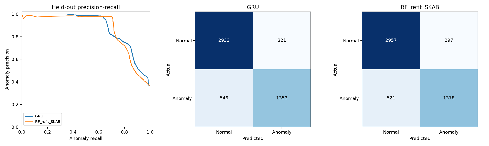

# GRU evaluation report

Dataset: Skoltech Anomaly Benchmark (SKAB v0.9), Katser and Kozitsin (2020), https://doi.org/10.34740/KAGGLE/DSV/1693952. Pinned commit: b2c0d46c2971dcbfe71e26087b6d231998bb91c2.

The GRU is integrated and faster/smaller in this experiment, but does **not** improve held-out accuracy, macro-F1 or anomaly recall over the refitted RF. Better PR/ROC ranking does not cancel the false-negative cost at the locked threshold.

[Complete methodology, feature definitions, integration and commands](../../docs/gru_sensor_model.md). The original vehicle RF is preserved. Its incompatible features/classes preclude direct SKAB evaluation; the comparable baseline clones its classifier settings and refits on SKAB endpoints.

## Dataset and selection

Binary endpoint target: normal=0, anomalous=1. No faulty subclass, malicious attribution or synthetic augmentation. Eight physical features retain the original feature order and training-only scaling.

Train: 33,623 windows (24,858 normal / 8,765 anomaly), 25 files / 20 overlap components. Validation: 4,863 (3,073 / 1,790), five components. Test: 5,153 (3,254 / 1,899), five components.

Chosen: one unidirectional GRU with 32 hidden units, 20 observations, dropout 0.2 and two-logit head. Best epoch 12; threshold 0.84; validation macro-F1 0.8989. AdamW lr=0.001, weight decay=0.0001, batch=256, weighted cross-entropy, seed=42, maximum 30 epochs / patience 5, gradient clipping 1.0. Training used GTX 1650 CUDA.

## Held-out metrics

| Model | Accuracy | Macro-F1 | Weighted F1 | Anomaly recall | FPR | FNR | AP | PR-AUC | ROC-AUC |
|---|---:|---:|---:|---:|---:|---:|---:|---:|---:|
| GRU | 0.8317 | 0.8143 | 0.8293 | 0.7125 | 0.0986 | 0.2875 | 0.8807 | 0.8806 | 0.8906 |
| RF_refit_SKAB | 0.8413 | 0.8248 | 0.8389 | 0.7256 | 0.0913 | 0.2744 | 0.8653 | 0.8657 | 0.8691 |

AP is average precision; PR-AUC is trapezoidal area, with anomaly positive.

| Model/class | Precision | Recall | F1 | Support |
|---|---:|---:|---:|---:|
| GRU/normal | 0.8431 | 0.9014 | 0.8712 | 3254 |
| GRU/anomalous | 0.8082 | 0.7125 | 0.7573 | 1899 |
| GRU/macro avg | 0.8257 | 0.8069 | 0.8143 | 5153 |
| RF_refit_SKAB/normal | 0.8502 | 0.9087 | 0.8785 | 3254 |
| RF_refit_SKAB/anomalous | 0.8227 | 0.7256 | 0.7711 | 1899 |
| RF_refit_SKAB/macro avg | 0.8364 | 0.8172 | 0.8248 | 5153 |

GRU confusion matrix, true rows / predicted columns [normal, anomalous]: `[[2933, 321], [546, 1353]]`.

RF_refit_SKAB confusion matrix, true rows / predicted columns [normal, anomalous]: `[[2957, 297], [521, 1378]]`.

GRU produced 321 false alarms and 546 misses; RF produced 297 false alarms and 521 misses. On other/14.csv (increased-temperature experiment), GRU anomaly recall is only 0.1424 (259 of 302 missed). This localized failure and distribution shift limit practical use. No threshold or architecture was changed after seeing test results.

## Timing and size

CPU: i5-10300H, four cores/eight logical processors; Windows 11, Python 3.12.6, PyTorch 2.7.1+cu126. Batch one, two Torch threads, 20 warm-ups and 200 repetitions. GRU includes preprocessing/conversion; RF uses prepared endpoint features and one sklearn worker.

| Model | CPU median ms | CPU p95 ms | Artifact bytes | Training seconds |
|---|---:|---:|---:|---:|
| GRU | 0.649 | 1.036 | 29606 | 20.72 |
| RF_refit_SKAB | 19.634 | 38.158 | 62893385 | 7.49 |

GRU size includes weights and metadata. GRU training time is for the selected candidate, not total search/CV; per-candidate times are retained in selection.json.

| Operation | Median ms | p95 ms |
|---|---:|---:|
| handshake | 0.0471 | 0.0500 |
| message_verification | 0.0164 | 0.0309 |
| application | 0.7726 | 1.0587 |

Application benchmark: 200/200 isolated commissioned nominal candidates accepted. Signing and commissioning are outside its timer; verification, GRU, policy and scheduling are inside. Handshake timing includes sender/receiver helper work; MAC timing excludes signing. This is an overhead benchmark, not a closed-loop detection experiment. EDF uses simulation units without any conversion from measured milliseconds. No formal real-time guarantee is claimed.

## Outer group robustness

Outer folds hold out training components. The separate original validation split selects checkpoints/thresholds; outer labels are scoring-only. These runs do not change the final artifact.

| Fold | GRU macro-F1 | RF macro-F1 |
|---|---:|---:|
| 0 | 0.9735 | 0.9846 |
| 1 | 0.7196 | 0.7485 |
| 2 | 0.7363 | 0.6690 |

Large inter-group variation reinforces the generalization limitation. Earlier inner diagnostics remain explicitly labelled and are not unbiased outer estimates.

## Security and validity

GRUHealthMonitor is the default backend. Statistical anomaly maps to anomalous_reading. Authentication, per-message MAC/replay, mandatory input validation, NIST risk policy, additional checks and EDF acceptance remain separate mandatory gates. Bounded source/session/run histories commit only on final acceptance. Cold start requires explicit trusted commissioning; distance-only vehicle messages fail closed. The dashboard exposes model, score, readiness and timing through backend audit, with an explicit RF baseline option and authenticated SKAB demo.

Water-domain performance does not validate a vehicle replacement. Accepted-only runtime context differs from offline complete recordings after rejection. Commissioning is trusted administration, not acceptance of rejected startup messages. Checksums are not artifact signatures. Correlated windows on one rig and five held-out groups do not establish deployment safety.

Final tests and file inventory: verification.json.

