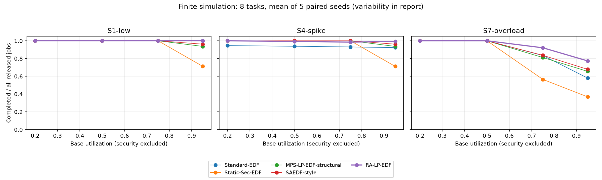

# Measured scheduler evaluation

3,500 main runs, 110 sensitivity/ablation runs, 700 paired workloads.
Seeds: [11, 22, 33, 44, 55]. Main-grid worker concurrency: 4.
Simulation units and assumed effectiveness; no hardware WCET or attack probability is measured.
Source hashes, pairing, recorded compliance, reservation counters and representative trace accounting verified.

## Representative fixed configuration: 8 tasks, base utilization 0.75

Values are means ± sample SD across five seeds. Completion denominator includes all released jobs.
Risk is conditioned on modeled execution, so read it alongside completion. Low risk is not necessarily best performance.

| Scenario | Algorithm | Released on time | Security overhead | Mean residual risk | Critical failures / rejections |
|---|---|---:|---:|---:|---:|
| S1-low | Standard-EDF | 1.0000 ± 0.0000 | 21.6152 ± 0.1577 | 0.0750 ± 0.0000 | 0 / 0 |
| S1-low | Static-Sec-EDF | 1.0000 ± 0.0000 | 127.1212 ± 0.8804 | 0.0100 ± 0.0000 | 0 / 0 |
| S1-low | MPS-LP-EDF-structural | 1.0000 ± 0.0000 | 69.2092 ± 0.9719 | 0.0100 ± 0.0000 | 0 / 0 |
| S1-low | SAEDF-style | 1.0000 ± 0.0000 | 74.6492 ± 1.0566 | 0.0100 ± 0.0000 | 0 / 0 |
| S1-low | RA-LP-EDF | 1.0000 ± 0.0000 | 18.4917 ± 2.7834 | 0.0662 ± 0.0035 | 0 / 0 |
| S4-spike | Standard-EDF | 0.9306 ± 0.0401 | 20.1488 ± 0.7613 | 0.0750 ± 0.0000 | 9 / 0 |
| S4-spike | Static-Sec-EDF | 1.0000 ± 0.0000 | 127.1212 ± 0.8804 | 0.0171 ± 0.0036 | 0 / 0 |
| S4-spike | MPS-LP-EDF-structural | 1.0000 ± 0.0000 | 69.2092 ± 0.9719 | 0.0164 ± 0.0029 | 0 / 0 |
| S4-spike | SAEDF-style | 1.0000 ± 0.0000 | 74.6492 ± 1.0566 | 0.0166 ± 0.0035 | 0 / 0 |
| S4-spike | RA-LP-EDF | 0.9849 ± 0.0207 | 21.5685 ± 3.0079 | 0.0688 ± 0.0025 | 2 / 0 |
| S7-overload | Standard-EDF | 0.8340 ± 0.0693 | 29.1546 ± 0.2091 | 0.0750 ± 0.0000 | 0 / 0 |
| S7-overload | Static-Sec-EDF | 0.5649 ± 0.0693 | 136.2849 ± 1.7872 | 0.0100 ± 0.0000 | 0 / 0 |
| S7-overload | MPS-LP-EDF-structural | 0.8114 ± 0.0256 | 85.9693 ± 2.0308 | 0.0100 ± 0.0000 | 0 / 2 |
| S7-overload | SAEDF-style | 0.8362 ± 0.0305 | 68.6578 ± 6.1355 | 0.0260 ± 0.0044 | 0 / 5 |
| S7-overload | RA-LP-EDF | 0.9210 ± 0.0297 | 17.6922 ± 3.8935 | 0.0715 ± 0.0040 | 0 / 1 |

## Paired differences at the same configuration

RA-LP-EDF minus each baseline; approximate normal 95% confidence interval over paired seed differences.
Positive completion is favorable; negative overhead is favorable. Five repeats are exploratory.

| Scenario | Baseline | Completion difference [CI] | Overhead difference [CI] |
|---|---|---:|---:|
| S1-low | Standard-EDF | 0.0000 [0.0000, 0.0000] | -3.1234 [-5.5218, -0.7250] |
| S1-low | Static-Sec-EDF | 0.0000 [0.0000, 0.0000] | -108.6295 [-111.3063, -105.9527] |
| S1-low | MPS-LP-EDF-structural | 0.0000 [0.0000, 0.0000] | -50.7175 [-52.8787, -48.5563] |
| S1-low | SAEDF-style | 0.0000 [0.0000, 0.0000] | -56.1575 [-58.2974, -54.0176] |
| S4-spike | Standard-EDF | 0.0543 [0.0372, 0.0714] | 1.4197 [-1.6861, 4.5255] |
| S4-spike | Static-Sec-EDF | -0.0151 [-0.0332, 0.0030] | -105.5527 [-108.6767, -102.4287] |
| S4-spike | MPS-LP-EDF-structural | -0.0151 [-0.0332, 0.0030] | -47.6407 [-50.2211, -45.0604] |
| S4-spike | SAEDF-style | -0.0151 [-0.0332, 0.0030] | -53.0807 [-55.4154, -50.7461] |
| S7-overload | Standard-EDF | 0.0870 [0.0476, 0.1264] | -11.4624 [-14.9891, -7.9356] |
| S7-overload | Static-Sec-EDF | 0.3561 [0.2836, 0.4286] | -118.5927 [-123.5394, -113.6459] |
| S7-overload | MPS-LP-EDF-structural | 0.1096 [0.0935, 0.1257] | -68.2771 [-73.3586, -63.1956] |
| S7-overload | SAEDF-style | 0.0848 [0.0590, 0.1106] | -50.9655 [-59.3817, -42.5494] |

## Ablations and sensitivity

All use S6-multiple, n=8, base utilization .75, the same five seeds. Workload changes are saved explicitly.
No-admission and no-reservation runs are diagnostic ablations, not recommended timing policies.

| Variant | Released on time | Security overhead | Safe-state events | Decision wall ms |
|---|---:|---:|---:|---:|
| default | 0.9608 ± 0.0027 | 37.5500 ± 2.2539 | 0.0000 ± 0.0000 | 51.3607 ± 24.7134 |
| no_dynamic | 1.0000 ± 0.0000 | 18.4917 ± 2.7834 | 0.0000 ± 0.0000 | 56.8766 ± 18.0441 |
| no_switch_awareness | 0.9608 ± 0.0027 | 37.5953 ± 1.9151 | 0.0000 ± 0.0000 | 48.1629 ± 9.2957 |
| no_preemption | 0.9608 ± 0.0027 | 37.6412 ± 2.4615 | 0.0000 ± 0.0000 | 42.7301 ± 6.1428 |
| no_admission | 0.9608 ± 0.0027 | 37.5500 ± 2.2539 | 0.0000 ± 0.0000 | 41.0073 ± 4.1790 |
| no_reservations | 0.9608 ± 0.0027 | 37.5500 ± 2.2539 | 0.0000 ± 0.0000 | 41.6898 ± 5.3969 |
| no_overload | 0.9608 ± 0.0027 | 37.5500 ± 2.2539 | 0.0000 ± 0.0000 | 52.5334 ± 18.2755 |
| risk_weight_low | 0.9608 ± 0.0027 | 32.6816 ± 1.0041 | 0.0000 ± 0.0000 | 53.3458 ± 23.9667 |
| risk_weight_high | 1.0000 ± 0.0000 | 74.6492 ± 1.0566 | 0.0000 ± 0.0000 | 46.4988 ± 7.7910 |
| cost_weight_high | 0.9608 ± 0.0027 | 32.6816 ± 1.0041 | 0.0000 ± 0.0000 | 42.4882 ± 2.2191 |
| switch_weight_high | 0.9608 ± 0.0027 | 38.8743 ± 1.2780 | 0.0000 ± 0.0000 | 45.3909 ± 8.3494 |
| thresholds_low | 0.9608 ± 0.0027 | 37.5500 ± 2.2539 | 0.0000 ± 0.0000 | 41.7760 ± 2.6743 |
| thresholds_high | 0.9608 ± 0.0027 | 37.5500 ± 2.2539 | 0.0000 ± 0.0000 | 47.6724 ± 17.0798 |
| cost_low | 1.0000 ± 0.0000 | 18.6723 ± 0.2715 | 0.0000 ± 0.0000 | 42.1974 ± 4.1998 |
| cost_high | 0.9608 ± 0.0027 | 86.0502 ± 4.1091 | 0.0000 ± 0.0000 | 50.1865 ± 7.3177 |
| one_phase | 0.9584 ± 0.0037 | 28.4790 ± 1.6022 | 0.2000 ± 0.4472 | 26.0928 ± 3.9826 |
| six_phases | 0.9589 ± 0.0053 | 54.0647 ± 3.3137 | 0.6000 ± 0.5477 | 89.2694 ± 46.2703 |
| all_critical | 0.9608 ± 0.0027 | 37.5500 ± 2.2539 | 1.0000 ± 0.0000 | 46.9325 ± 10.9035 |
| no_critical | 0.9608 ± 0.0027 | 37.5500 ± 2.2539 | 0.0000 ± 0.0000 | 52.4167 ± 10.2032 |
| wcet_overrun | 0.0000 ± 0.0000 | 10.9161 ± 0.9428 | 6.8000 ± 1.0954 | 10.5614 ± 2.5284 |
| wcet_slack | 1.0000 ± 0.0000 | 31.9917 ± 2.4169 | 0.0000 ± 0.0000 | 47.0681 ± 21.6188 |
| zero_preemptions | 0.9608 ± 0.0027 | 37.6412 ± 2.4615 | 0.0000 ± 0.0000 | 56.1980 ± 27.7604 |

## Interpretation limits

The proposed policy trades assumed residual risk against overhead; it is not uniformly superior to strongest protection.
Sudden risk can cause intentional fail-stop of a protected job already inside a weaker atomic interval.
That failure is visible and must not be presented as preserving every critical deadline. Admission uses released demand only.
Recorded execution compliance against each run's active policy is 1 in every nonempty measured run and reservation violations are zero; these are finite simulator observations, not security proofs.
The no_dynamic ablation ignores new threat evidence: its policy-relative compliance and residual-risk metric cannot establish compliance with the changing external scenario. Its higher completion is not a safe security improvement.
Standard EDF and Static-Sec-EDF use 1-unit checkpoints. MPS is structural and SAEDF is a single-CPU approximation.
Hardware deployment, global optimality, faithful published-baseline superiority and infinite dynamic schedulability remain unproved.

## Artifacts and commands

`raw.json`, `workloads.json`, `aggregates.json`, `paired.json`, `sensitivity.json`, `metadata.json` and 35 representative traces retain the evidence.

```powershell
.\.venv\Scripts\python.exe -u -m src.scheduler.experiments --full --workers 4
.\.venv\Scripts\python.exe scripts/report_scheduling.py
```


